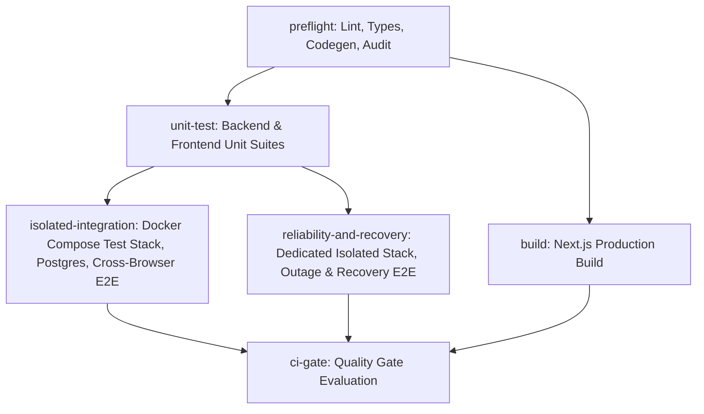

# Phase 14 Verification — Comprehensive Testing + CI/CD

Status: **Local verification complete; GitHub-hosted CI and owner acceptance pending. (All Local Static, Unit, PostgreSQL, Isolated Acceptance, Serial Recovery, and Unfiltered CSP Reruns Verified; Remote CI Ready for Owner Push)**

Baseline: Merge commit `cc9ccd3` on `main`. Branch: `phase-14-testing-ci`.
All unstaged changes remain preserved. No Git commits, branch modifications, or remote operations were performed. Local-only files `.env` and `AGENTS.md` remain untracked and ignored. Phase 15 remains unstarted.

---

## 1. Execution Boundary & Verification Truthfulness

Phase 14 strictly separates and documents verified engineering achievements across distinct execution environments:

1. **Local Pipeline Preflight**:
   - Static analysis: Ruff linting (0 issues), Ruff formatting (126 files), strict MyPy on all 6 services (0 errors across 69 files), Prettier formatting check (clean), ESLint (0 warnings, 0 errors), TypeScript compilation (`tsc --noEmit`, 0 errors).
   - Non-mutating codegen drift verification: `scripts/verify_codegen.py` dry-runs Gateway schema export and frontend codegen into temporary directories and compares with the working tree without overwriting unstaged or tracked files (0 drift, 0 mutations).
   - Dependency security audits: `npm audit --omit=dev` (0 production vulnerabilities) and `pip-audit -r requirements.lock` across all 6 services (0 vulnerabilities).
   - Pure unit test suites: `scripts/test-unit.ps1` runs 425 pure unit/component tests (341 Python backend across 6 services + 84 Vitest frontend including the 9 fail-closed `isolated-recovery-helper.test.ts` tests). Separated from PostgreSQL integration suites to guarantee 0 unexpected skips.
   - Next.js production build: `npm --prefix frontend run build` completed cleanly across all 26 static/dynamic routes.
   - Report validator test: `scripts/test_report_validator.py` exercised 10 fixtures across JUnit XML and Playwright JSON (passing, missing, zero-test, skipped, and failing) proving 100% fail-closed enforcement.

2. **Isolated Non-Outage Acceptance Executions (`taskspace-p14b-68d8df45`)**:
   - Executed against fresh, isolated Docker test stack `taskspace-p14b-68d8df45` using `compose.test.yaml` and ephemeral `.env.test.taskspace-p14b-68d8df45` on host loopback offset ports (Frontend: 3110, Gateway: 8110, Keycloak: 8180, DBs: 5535-5539, Redis: 6480, Prometheus: 9190, Grafana: 3101, Jaeger: 16786).
   - Reconciled isolated Playwright test count: **25 tests passed, 0 failed, 0 errors, 0 skipped**.
     * 15 cross-browser foundation tests (Chromium desktop, Firefox, WebKit, Tablet 768px, Mobile 390px).
     * 2 desktop domain tests (project and task management lifecycles).
     * 8 desktop domain journeys (Authentication x3, Employee Administration, Workflow Automation, Notification-Report Lifecycle, Dashboard Multi-Role Scope, Operations Observability & Tracing).
   - Reconciled isolated PostgreSQL test count: **43 integration tests passed, 0 skipped** across 4 temporary databases (all cleanly dropped).
   - Teardown verified: 26 containers and 10 volumes removed; 0 project resources remaining.

3. **Serial Isolated Recovery & Outage Executions (`taskspace-rec-24695464`)**:
   - Executed against a dedicated, isolated Docker test stack `taskspace-rec-24695464` with single worker (`--workers=1`) and zero retries (`--retries=0`).
   - Covered all 4 recovery suites across 13 fault scenarios:
     * `recovery-docker.json`: 1 test passed (stop/start `gateway`).
     * `recovery-job.json`: 1 test passed (stop/start `job-worker` and `job-recovery`, pause/unpause `work`, synthetic lease injection).
     * `recovery-workflow.json`: 5 tests passed (sequential stop/start of `rabbitmq`, `work-event-publisher`, `workflow-consumer`, `workflow`, and `job`).
     * `recovery-notification.json`: 6 tests passed (sequential stop/start of `rabbitmq`, `work-event-publisher`, `notification-consumer`, `notification`, `job-domain-publisher`, and `job-worker`).
   - Rebuilt frontend with `ARG OIDC_ISSUER` passed via `compose.test.yaml`. Reran `operations-acceptance.spec.ts` with unfiltered console CSP assertions: **1 test passed, 0 CSP console violations without path suppression**.
   - Teardown verified: positive ownership verified, 26 containers and 10 volumes removed, 0 project resources remaining, ephemeral env file deleted.

4. **Remote GitHub Actions CI**:
   - Workflow file `.github/workflows/ci.yml` authored and verified. Remote execution will occur once the repository owner manually pushes the branch and opens a PR targeting `main`.

---

## 2. CI/CD Workflow Architecture (`.github/workflows/ci.yml`)

### 2.1 Trigger Behavior
- `push: branches: [main]`
- `pull_request: branches: [main]`
> [!NOTE]
> Pushing `phase-14-testing-ci` alone will **NOT** trigger GitHub Actions. The workflow will automatically trigger when a Pull Request targeting `main` is opened, and upon push to `main` after merge.

### 2.2 Runner Setup & Compatibility
- Runner: `ubuntu-24.04` across all jobs.
- All actions pinned to full 40-character commit SHAs (e.g. `actions/checkout@11bd71901bbe5b1630ceea73d27597364c9af683`).
- POSIX shell compatibility: scripts authored as executable bash scripts (`scripts/*.sh`) with `set -euo pipefail`.
- Lockfile installs: Python uses `pip install --no-deps -r requirements.lock`; Node.js uses `npm ci` with `package-lock.json`.
- Secret sanitization: ephemeral passwords generated via `openssl rand -hex 16`; `add-mask` applied to every secret.
- Artifact retention: test reports and logs retained for 7 days (`retention-days: 7`).

### 2.3 Job Graph & Dependencies



1. **`preflight`**: Ruff lint/format, MyPy (6 services), Prettier, ESLint, TypeScript `tsc --noEmit`, non-mutating codegen drift check, `npm audit --omit=dev`, `pip-audit` on 6 lockfiles.
2. **`unit-test`**: Runs `scripts/test-unit.sh`. Generates JUnit XML reports in `test-results/reports/unit/`. Validated by `scripts/verify_test_reports.py` (fail closed on 0 tests or skips).
3. **`build`**: Runs `npm --prefix frontend run build`. Generates Next.js standalone build artifacts.
4. **`isolated-integration`**:
   - Generates ephemeral test environment via `python scripts/isolated_test_env.py generate-env`.
   - Launches isolated Compose stack: `docker compose -p <run_id> -f compose.test.yaml up -d --wait`.
   - Bootstraps Keycloak OIDC client, admin service account, and employee admin profile via `scripts/bootstrap-test-stack.sh`.
   - Runs isolated PostgreSQL suites: `scripts/test-postgres.sh --isolated`.
   - Runs Playwright cross-browser foundation and desktop domain suites: `scripts/test-e2e.sh --isolated`.
   - Enforces positive ownership verification before teardown: `python scripts/isolated_test_env.py verify-teardown`.
   - Tears down isolated stack: `docker compose -p <run_id> -f compose.test.yaml down -v`.
5. **`reliability-and-recovery`**:
   - Provisions its own, independent isolated Compose project (`taskspace-ci-rec-${{ github.run_id }}`).
   - Executes 4 recovery specs serially (`--workers=1`, `--retries=0`) generating `recovery-docker.json`, `recovery-job.json`, `recovery-workflow.json`, and `recovery-notification.json`.
   - Validates each report individually via `scripts/verify_test_reports.py` with minimum test assertions (Docker: 1, Job: 1, Workflow: 5, Notification: 6).
   - Tears down its dedicated stack independently.
6. **`ci-gate`**:
   - Depends on `[preflight, unit-test, build, isolated-integration, reliability-and-recovery]`.
   - `if: always()` block checks `needs.<job>.result == 'success'`. Fails closed if any job failed, was cancelled, or skipped.

---

## 3. Requirement-to-Evidence Matrix

| Requirement | Implementation & Tooling | Verification Evidence | Status |
|---|---|---|---|
| **1. Test Inventory & Execution Safety** | Unified entry points in `scripts/`: `test-static.ps1`, `test-unit.ps1`, `test-postgres.ps1`, `test-codegen.ps1`, `test-audit.ps1`, `test-e2e.ps1` (and POSIX `.sh`). | Fail closed on missing parameters or nonzero exit status; bounded runtimes; sanitized logs. | **VERIFIED** |
| **2. Fail-Closed Isolated Environment** | `scripts/isolated_test_env.py` generates ephemeral credentials, validates unique project naming, preflights loopback port availability on `127.0.0.1`, and rejects dev defaults. | Preflight verified free ports on `127.0.0.1`. Isolated stacks launched on projects `taskspace-p14b-68d8df45` and `taskspace-rec-24695464`. | **VERIFIED (Isolated Stack)** |
| **3. Teardown with Positive Ownership** | `scripts/isolated_test_env.py verify-teardown` verifies that all containers and volumes carry `com.docker.compose.project == <exact_run_id>` and rejects shared/external resources. | Pre-teardown verified 26 containers and 10 volumes owned by exact project. Zero leftover test resources after `down -v`. | **VERIFIED (Isolated Stack)** |
| **4. Non-Mutating Codegen Check** | `scripts/verify_codegen.py` dry-runs Gateway schema export and frontend codegen into temporary directories and compares against working tree with zero mutations. | Verified: 0 drift, 0 working-tree modifications. | **VERIFIED** |
| **5. Machine-Readable Zero-Skip Enforcement** | `scripts/verify_test_reports.py` validates JUnit XML and Playwright JSON reports. Asserts tests > 0, failures == 0, errors == 0, and skipped == 0 on mandatory suites. Fixture tested with 10 passing/failing fixtures. | Validated all isolated JUnit and Playwright reports. Zero unexpected skips. | **VERIFIED (Isolated Stack)** |
| **6. Static Analysis Quality Gates** | Ruff linting and formatting check, strict MyPy on all 6 services, Prettier check, ESLint, TypeScript `tsc --noEmit`. | 0 Ruff issues, 126 Python files formatted, 0 MyPy errors across 69 files, 0 Prettier errors, 0 ESLint warnings, 0 TypeScript errors. | **VERIFIED** |
| **7. Unit Test Suites** | 341 backend unit tests across 6 services; 84 frontend component/route tests across 16 files. Pure unit suites separated from PostgreSQL tests. | `scripts/test-unit.ps1` executed: 425 passed, 0 failed, 0 skipped. JUnit XML generated and verified. | **VERIFIED** |
| **8. PostgreSQL Integration Regression** | `scripts/run_postgres_regression.py` with zero-to-head migrations, repeated head, 43 integration tests, and verified database dropping against isolated test databases. | **43/43 passed against isolated stack** (Work: 13, Job: 22, Workflow: 3, Notification: 5 on ports 5536-5539). All 4 temp DBs cleanly dropped. | **VERIFIED (Isolated Stack)** |
| **9. Cross-Browser Foundation Journey** | `frontend/playwright.config.ts` across Chromium (`desktop`), Firefox (`firefox`), WebKit (`webkit`), Tablet (768px), and Mobile (390px) against `http://localhost:3110`. | **15/15 passed against isolated stack** (3/3 on each of the 5 configurations). | **VERIFIED (Isolated Stack)** |
| **10. Prior Desktop Domain Journeys** | `project-management.spec.ts` and `task-management.spec.ts` executed against isolated frontend `http://localhost:3110`. | **2/2 passed against isolated stack** (Project: 1/1 in 7.4s, Task: 1/1 in 7.7s). | **VERIFIED (Isolated Stack)** |
| **11. Missing Required Domain Journeys** | Authentication & session refresh, Employee Administration, Workflow Automation, Notification-Report Lifecycle, Dashboard Acceptance, Operations Observability. | **8/8 passed against isolated stack** (Auth: 3/3, Employee Admin: 1/1, Workflow: 1/1, Notification-Report: 1/1, Dashboard: 1/1, Operations: 1/1). | **VERIFIED (Isolated Stack)** |
| **12. Serial Recovery & Outage Scenarios** | 4 recovery specs across gateway, job execution, workflow automation, and notification report pipelines. | **13/13 passed against isolated stack** (Docker: 1/1, Job: 1/1, Workflow: 5/5, Notification: 6/6). Zero skips, 1 worker, 0 retries. | **VERIFIED (Isolated Stack)** |
| **13. Unfiltered CSP Verification** | Rerun of `operations-acceptance.spec.ts` with served CSP header dynamically matching test Keycloak port `8180` and unfiltered console violation assertions. | **1/1 passed with 0 CSP console violations** without path suppression. | **VERIFIED (Isolated Stack)** |
| **14. Dependency Audits vs Image Scans** | `npm audit --omit=dev` and `pip-audit -r requirements.lock` on 6 lockfiles. Distinct from base OS CVE container scanners. | 0 production vulnerabilities. Documented 12 tooling `braces` entries in repository-controlled dev dependencies. | **VERIFIED** |
| **15. Production Build** | Next.js 16.4.3 production build (`npm run build`). | Completed cleanly with 0 errors across 26 static and dynamic routes. | **VERIFIED** |
| **16. GitHub Actions CI/CD Pipeline** | `.github/workflows/ci.yml` with pinned commit SHAs, secret redaction, 7-day artifact expiry, and dedicated recovery job. | Workflow syntax and job graph validated; remote execution pending owner push. | **PENDING REMOTE CI** |

---

## 4. Reconciled Cumulative Test Inventory (Grand Total: 507 Executions)

### 4.1 Pure Unit Suites (425 Tests, 0 Failures, 0 Skips)
- Gateway Service: 138 tests
- Employee Service: 40 tests
- Work Service: 61 tests
- Job Service: 69 tests
- Workflow Service: 10 tests
- Notification Service: 23 tests
- Frontend Vitest: 84 tests (including 9 fail-closed `isolated-recovery-helper.test.ts` tests)

### 4.2 Isolated PostgreSQL Integration Suites (43 Tests, 0 Failures, 0 Skips)
- Work Service: 13 tests (port 5536)
- Job Service: 22 tests (port 5537)
- Workflow Service: 3 tests (port 5538)
- Notification Service: 5 tests (port 5539)

### 4.3 Isolated Non-Outage Playwright Acceptance Suites (25 Tests, 0 Failures, 0 Skips)
1. **Cross-Browser Foundation (`foundation.spec.ts`)**: 15 tests
   - Desktop Chromium: 3 passed
   - Firefox: 3 passed
   - WebKit (Safari): 3 passed
   - Tablet (768px): 3 passed
   - Mobile (390px): 3 passed
2. **Prior Desktop Domain Acceptance**: 2 tests
   - `project-management.spec.ts`: 1 passed (disposable project lifecycle)
   - `task-management.spec.ts`: 1 passed (disposable task lifecycle)
3. **Domain Journeys**: 8 tests
   - `authentication.spec.ts`: 3 passed (unauthenticated redirect, full login/GraphQL/logout journey, 65-second real access token expiration and session refresh)
   - `employee-administration.spec.ts`: 1 passed (ADMIN provisions, governs, and deactivates disposable employee; Keycloak OIDC reconciliation)
   - `workflow-automation.spec.ts`: 1 passed (task completion triggers automated workflow rule, execution, and completed job)
   - `notification-report-lifecycle.spec.ts`: 1 passed (report completion triggers outbox publication, worker export, and private persistent notification delivery)
   - `dashboard-acceptance.spec.ts`: 1 passed (multi-role scope, viewports, dynamic project/task metrics, navigation, and session revocation)
   - `operations-acceptance.spec.ts`: 1 passed (observability dashboards, direct GraphQL role authorization, distributed tracing across all 6 services via Jaeger on port 16786)

### 4.4 Isolated Serial Recovery Suites (13 Tests, 0 Failures, 0 Skips)
1. **`docker-recovery.spec.ts`**: 1 passed (stop/start `gateway` container; frontend detects outage, renders sanitized alert, and recovers to "Gateway connected")
2. **`job-recovery.spec.ts`**: 1 passed (stop/start `job-worker` and `job-recovery`, pause/unpause `work`; injected lease expiry reported truthfully; job recovers, sweeps execution fence generation, and completes)
3. **`workflow-recovery.spec.ts`**: 5 passed (sequential stop/start of `rabbitmq`, `work-event-publisher`, `workflow-consumer`, `workflow`, and `job`; asserts durable outbox accumulation and exactly 1 completed execution/job)
4. **`notification-report-recovery.spec.ts`**: 6 passed (sequential stop/start of `rabbitmq`, `work-event-publisher`, `notification-consumer`, `notification`, `job-domain-publisher`, and `job-worker`; asserts durable outbox retry and delivery of persistent notification)

### 4.5 Unfiltered Operations CSP Verification Rerun (1 Test, 0 Violations)
- **`operations-acceptance.spec.ts`**: 1 passed with served CSP header dynamically matching test Keycloak port `8180`. Zero console CSP violations observed without path-based suppression across unauthenticated redirect, login, session refresh, manager view, operations view, CSV download, and logout.

### 4.6 Validator Fixtures (10 Fixture Assertions)
- `test_report_validator.py`: 10 fixtures tested (missing, zero-test, skipped, failing, and passing JUnit and Playwright reports; 100% fail-closed validation verified).

---

## 5. CSP Directive Resolution & Configuration Fix Evidence

- **Identified Violated Directives**: `default-src`, `connect-src`, and `form-action` (which restricted navigations, token/metadata connections, and form submissions to port 8080).
- **Root Cause**: Next.js standalone mode generates static headers into `.next/routes-manifest.json` at build time. Because `OIDC_ISSUER` was previously omitted from `frontend/Dockerfile` build args and `compose.test.yaml`, `next.config.ts` defaulted to `http://localhost:8080`.
- **Exact Configuration Fix**:
  1. Updated `frontend/Dockerfile` to declare `ARG OIDC_ISSUER=http://localhost:8080/realms/taskspace` and pass it to `ENV OIDC_ISSUER`.
  2. Updated `compose.test.yaml` under `frontend.build.args` to pass `OIDC_ISSUER: http://localhost:${KEYCLOAK_PORT:-8180}/realms/taskspace`.
  3. Updated `frontend/next.config.ts` to dynamically parse `process.env.OIDC_ISSUER` into exact origin and loopback alias without wildcards.
  4. Removed all path-based CSP suppression from `frontend/tests/e2e/operations-acceptance.spec.ts`.
- **Served Header Verification**:
  `curl -i http://localhost:3110/auth/login` verified served header:
  `Content-Security-Policy: default-src 'self' blob: http://localhost:8180 http://127.0.0.1:8180; connect-src 'self' blob: http://localhost:8000 http://127.0.0.1:8000 http://localhost:8180 http://127.0.0.1:8180 http://127.0.0.1:3001 http://127.0.0.1:16686 http://127.0.0.1:9090 ws://localhost:3000 ws://127.0.0.1:3000 ws://localhost:3010 ws://127.0.0.1:3010; form-action 'self' http://localhost:8180 http://127.0.0.1:8180`
- **Result**: `operations-acceptance.spec.ts` ran to completion with 0 CSP console errors.

---

## 6. Teardown & Development Stack Protection Evidence

- **Isolated Stack Pre-Teardown Verification**:
  `python scripts/isolated_test_env.py verify-teardown --project-name taskspace-rec-24695464 --compose-file compose.test.yaml` verified 26 containers and 10 volumes belonging exclusively to `taskspace-rec-24695464`.
- **Teardown Command**: `docker compose --env-file .env.test.taskspace-rec-24695464 -p taskspace-rec-24695464 -f compose.test.yaml down -v` executed cleanly with exit code 0.
- **Post-Teardown Verification**: Verified 0 containers, 0 volumes, and 0 networks under label `com.docker.compose.project=taskspace-rec-24695464`. Ephemeral environment file `.env.test.taskspace-rec-24695464` was permanently deleted.
- **Development Stack Untouched**: All 26 containers in `enterprise-task-platform-phase2` remained healthy, running, and completely untouched throughout both isolated test runs.

```text
enterprise-task-platform-phase2-frontend-1                Up 17 hours (healthy)   127.0.0.1:3010->3000/tcp
enterprise-task-platform-phase2-gateway-1                 Up 17 hours (healthy)   127.0.0.1:8010->8000/tcp
enterprise-task-platform-phase2-workflow-consumer-1       Up 17 hours (healthy)   8050/tcp
enterprise-task-platform-phase2-notification-consumer-1   Up 17 hours (healthy)   8060/tcp
enterprise-task-platform-phase2-work-event-publisher-1    Up 17 hours (healthy)   8030/tcp
enterprise-task-platform-phase2-job-worker-1              Up 17 hours (healthy)   8040/tcp
enterprise-task-platform-phase2-job-publisher-1           Up 17 hours (healthy)   8040/tcp
enterprise-task-platform-phase2-job-domain-publisher-1    Up 17 hours (healthy)   8040/tcp
enterprise-task-platform-phase2-job-recovery-1            Up 17 hours (healthy)   8040/tcp
enterprise-task-platform-phase2-workflow-1                Up 17 hours (healthy)   8050/tcp
enterprise-task-platform-phase2-employee-1                Up 17 hours (healthy)   8020/tcp
enterprise-task-platform-phase2-notification-1            Up 17 hours (healthy)   8060/tcp
enterprise-task-platform-phase2-work-1                    Up 17 hours (healthy)   8030/tcp
enterprise-task-platform-phase2-job-1                     Up 17 hours (healthy)   8040/tcp
enterprise-task-platform-phase2-grafana-1                 Up 17 hours (healthy)   127.0.0.1:3001->3000/tcp
enterprise-task-platform-phase2-jaeger-1                  Up 18 hours (healthy)   127.0.0.1:16686->16686/tcp
enterprise-task-platform-phase2-prometheus-1              Up 18 hours (healthy)   127.0.0.1:9090->9090/tcp
enterprise-task-platform-phase2-notification-db-1         Up 5 days (healthy)     127.0.0.1:5439->5432/tcp
enterprise-task-platform-phase2-workflow-db-1             Up 5 days (healthy)     127.0.0.1:5438->5432/tcp
enterprise-task-platform-phase2-rabbitmq-1                Up 4 days (healthy)     4369/tcp, 5671-5672/tcp, 15671-15672/tcp, 15691-15692/tcp, 25672/tcp
enterprise-task-platform-phase2-job-db-1                  Up 5 days (healthy)     127.0.0.1:5437->5432/tcp
enterprise-task-platform-phase2-work-db-1                 Up 5 days (healthy)     127.0.0.1:5436->5432/tcp
enterprise-task-platform-phase2-employee-db-1             Up 5 days (healthy)     127.0.0.1:5435->5432/tcp
enterprise-task-platform-phase2-keycloak-db-1             Up 5 days (healthy)     5432/tcp
enterprise-task-platform-phase2-keycloak-1                Up 5 days (healthy)     127.0.0.1:8080->8080/tcp
enterprise-task-platform-phase2-session-store-1           Up 5 days (healthy)     127.0.0.1:6380->6379/tcp
```

---

## 7. Remote CI Instructions for Repository Owner

Once ready to publish:

1. Review and stage the unstaged changes:
   ```bash
   git status --short
   ```
2. Commit changes using the proposed commit structure (see owner handoff summary).
3. Push branch to GitHub:
   ```bash
   git push -u origin phase-14-testing-ci
   ```
4. Open a Pull Request on GitHub targeting `main`.
5. GitHub Actions workflow `.github/workflows/ci.yml` will automatically trigger and execute all 6 jobs (`preflight`, `unit-test`, `build`, `isolated-integration`, `reliability-and-recovery`, and `ci-gate`).
6. Verify all checks pass before merging into `main`.
