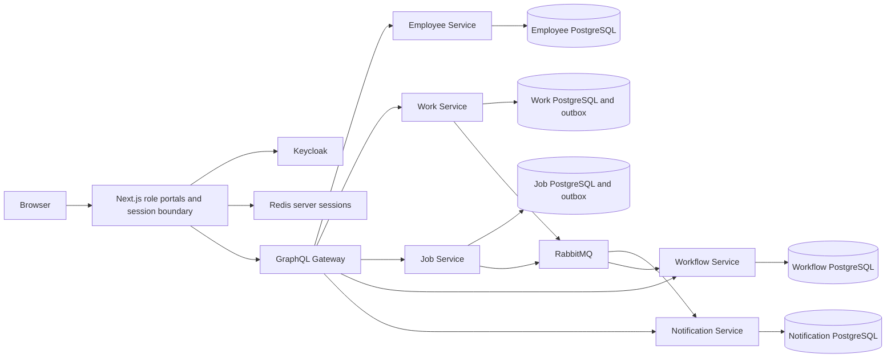

# Portal interface transition

## Owner direction

On 2026-11-13 the owner requested that signed-in users see the new portal
interface exclusively. This supersedes the earlier interface coexistence and
stage-order assumptions for the portal entry work. The original
portal-refinement-plan.md remains read-only. This record describes the scoped
implementation and does not mark the remaining roadmap complete.

## Structure and service boundaries

- frontend/src/app/(protected)/portals/[portal] owns authenticated route composition.
- frontend/src/components/portal-shell owns the responsive signed-in shell.
- frontend/src/features/portals owns role routing and live overview composition.
- frontend/src/components/portal-ui owns reusable visual primitives.
- Existing feature modules retain working domain forms and service clients.
- The GraphQL Gateway remains the public backend boundary. Employee, Work,
  Job, Workflow, and Notification remain separate services and databases.
- Keycloak owns credentials, and Redis holds server-side sessions.

The root redirects to the current user's portal. Each portal request reloads
the Employee profile through Gateway and checks the portal against the actual
company role. Administrator status does not grant entry to another role's
portal. Existing service authorization remains authoritative for every domain
operation. Unsupported roles fail closed.

Admin, Manager, and Employee map to the current ADMIN, MANAGER, and MEMBER
backend roles. HR and project-scoped team leadership require the later domain
and authorization work in the original roadmap. No role, calendar, review,
extension, or employment data is fabricated.

## Retired interface

The original sidebar shell, combined overview implementation, and mixed legacy
design-system screen were removed. Existing business pages moved into portal
routes. Old bookmarks use a redirect-only compatibility entry with query
preservation; they render no old interface. Reusable service-connected features
remain in their domain modules and use the new semantic palette and portal links.

## Verification

The final frontend image built successfully and was recreated without changing
backend service configuration or persistent data. All 26 configured services
were running and healthy after the update. Sign-in returned HTTP 200, and
compiled assets contained the new role overview.

- Frontend full collection passed 103 tests in 18 files.
- After the empty-chart correction, the focused portal UI collection passed
  20 tests. Zero-count slices no longer draw a misleading marker.
- Gateway regression collection passed 138 tests.
- Frontend lint, typecheck, formatting, and production build passed.
- Credentialed portal acceptance passed desktop, tablet, and mobile with one
  worker and zero retries. The final run passed 3 tests in 29.4 seconds.
- The selected non-destructive authentication and migrated foundation browser
  checks passed 5 desktop tests in 19.7 seconds with zero retries.
- Browser checks covered sign-in, live overview, absence of sample/retired
  shell content, responsive overflow, mobile drawer focus restoration,
  old-bookmark redirects with query preservation, access denial for another
  role's portal, logout, and protected entry after logout.
- Desktop and mobile screenshots were visually inspected. Screenshots are in
  frontend/test-results/portal-final and are excluded from the change set.

The first route typecheck referenced removed route files in generated Next.js
validators. Regenerating route types resolved those stale generated references.
The first navigation regression runs failed because the original link adapter
required a router hook missing from existing domain test mocks. The adapter now
uses a portal-path context, and the focused 32-test rerun plus full 103-test
rerun passed. One earlier authentication journey remained at Signing out past
its five-second assertion. The unchanged check passed against the final image;
no cause is inferred from the earlier pending state, and its timeout was not
increased.

## Remaining acceptance scope

Admin portal runtime was exercised using the existing local administrator.
Manager and Employee rendering and portal mapping were covered by component
and policy tests; separate credentialed journeys for those identities remain
required. The broader domain and destructive browser suites still include
old-route and old-dashboard expectations and need deliberate migration and
execution before a complete CI acceptance claim. Existing CI gates were kept.

This delivers the portal-only entry, shell, and service-connected overview.
It does not mark the complete R1–R15 programme accepted. HR account support,
project team-leader semantics, calendars, review and extension workflows, HR
lifecycle, and final replacement hardening remain the later domain work from
the read-only specification. No migration, credential reset, account role
change, or service consolidation was performed.

## Request and event flow

Application UI code does not connect to service databases. Domain services
retain their own persistence and authorization. Durable events use the existing
outbox and RabbitMQ paths. No new combined database or duplicate business layer
was introduced for the portal interface.
